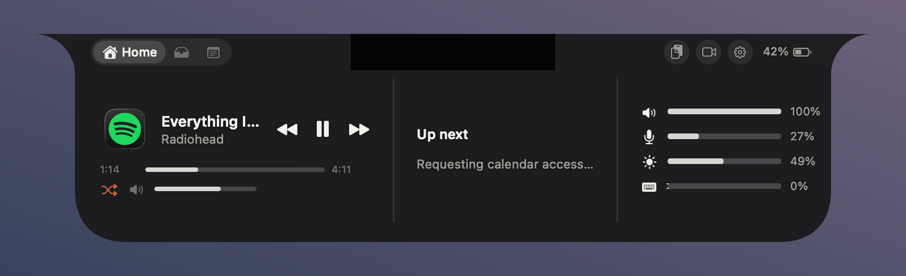
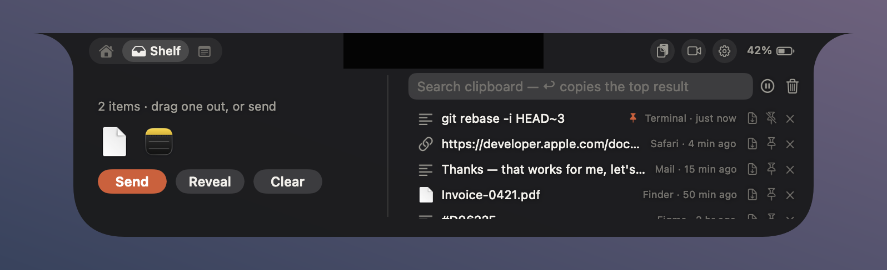
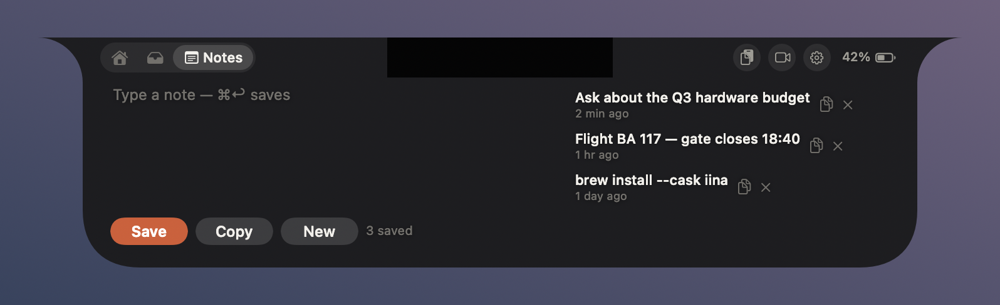
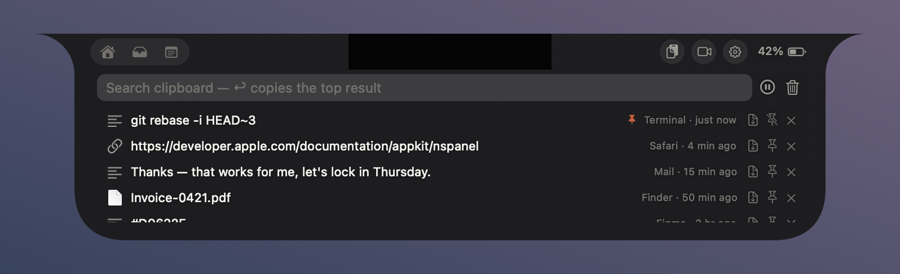
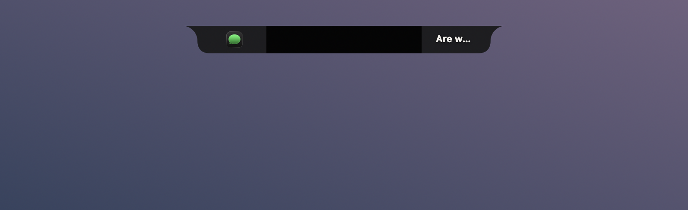

<p align="center">
  
</p>

<h1 align="center">NotchHover</h1>

<p align="center">
  Your MacBook's notch, put to work.<br>
  Music, files, clipboard, notes and Claude Code approvals — one hover away.
</p>

<p align="center">
  <a href="https://github.com/BelalElrashidy/NotchHover/releases/latest"></a>
  
  
  <a href="LICENSE"></a>
</p>

<p align="center">
  
</p>

---

NotchHover turns the dead space around the MacBook notch into a small control surface.
Hover the notch and a panel grows out of it — Home, Shelf and Notes to the left of the
notch, the clipboard, mirror and settings to its right — and move away and it sinks back. While something
plays, a slim bar hugs the notch with the artwork and a live meter — and when your volume
changes or a notification lands, the notch pops to show it.

Everything runs on your Mac. There are no accounts, no servers and no analytics.

## Features

**Now playing**
- Spotify and Apple Music with artwork, scrubbing, shuffle and volume
- Anything else that plays sound is shown too — a video in your browser appears as the
  site it's on, with that site's own icon
- Pinned playlists you can start from the notch

**Live activities**
- Volume, brightness, keyboard backlight, battery and timer changes pop out of the notch
- Notification banners are mirrored into it
- The resting bar takes a breath when something starts playing

**Getting things done**
- **Shelf** — drop files on the notch to hold them, beside your most recent clips; drag
  them out later, or AirDrop them
- **Clipboard history** — search, pin and paste back with <kbd>⌃</kbd><kbd>⌥</kbd><kbd>V</kbd>
- **Quick notes** — <kbd>⌃</kbd><kbd>⌥</kbd><kbd>N</kbd> to start one, <kbd>⌘</kbd><kbd>↩</kbd> to keep it
- **Controls** — output volume, microphone gain and mute, display brightness, keyboard backlight
- Calendar, countdown timer, macOS Shortcuts and app launchers

**Claude Code**
- Approve or deny Claude Code's tool calls from the notch, without switching windows.
  Nothing else in this space does it.

**Yours to shape**
- Six themes, from solid graphite to Liquid Glass
- Rearrange the widgets, resize the panel and the resting bar, adjust corner radius and flare

<table>
  <tr>
    <td></td>
    <td></td>
  </tr>
  <tr>
    <td></td>
    <td></td>
  </tr>
</table>

## Install

1. Download **NotchHover-x.y.z.zip** from the [latest release](https://github.com/BelalElrashidy/NotchHover/releases/latest).
2. Unzip it and drag **NotchHover.app** into **Applications**.
3. Open it.

**The first launch will be blocked.** NotchHover isn't notarized by Apple yet, so macOS
refuses to open it the first time. To allow it, either:

- open **System Settings → Privacy & Security**, scroll down, and click **Open Anyway**
  next to NotchHover; or
- run this once in Terminal:

  ```bash
  xattr -dr com.apple.quarantine /Applications/NotchHover.app
  ```

NotchHover has no Dock icon and no menu bar icon — it lives entirely in the notch. Hover
it to begin.

**Requirements:** macOS 14 Sonoma or later, on Apple silicon. Macs without a notch get a
slim strip at the top centre of the screen instead.

## Permissions

Every permission is optional. Each one only switches on the feature beside it, and macOS
asks the first time that feature is used.

| Permission | What it's for |
|---|---|
| Automation → Spotify, Music | Reading what's playing and controlling playback |
| Automation → Safari | Naming the page Safari is playing |
| Accessibility | Mirroring notification banners into the notch |
| Calendars | Showing your next events |
| Camera | The mirror |

Seeing which app is playing needs no permission, and neither does naming the page in
Firefox, Zen and other Firefox-based browsers — they keep their open tabs, favicons
included, in a file NotchHover can read. Safari's favicons are locked away, so a Safari
page shows Safari's icon.

## Claude Code approvals

NotchHover can answer Claude Code's permission prompts for you. A small hook forwards
each request to the app over a loopback socket, protected by a token only your user can
read; the request appears in the notch, and your answer goes straight back to Claude Code.
If you don't answer within 50 seconds, Claude Code falls back to its own prompt — the
notch never approves anything on its own.

The hook lives in this repository, so clone it and run:

```bash
Scripts/install-claude-hook.sh
```

`Scripts/install-claude-hook.sh --uninstall` removes it, and your previous settings are
kept in `~/.claude/settings.json.notchhover-backup`.

## Privacy

NotchHover makes no network requests of its own, with one exception: Spotify only hands
out artwork as a link, so album art for Spotify tracks is fetched from Spotify's image
server. No account information is sent with that request.

Clipboard history, notes and the shelf are stored in your user's Application Support
folder, readable only by you. Password managers mark what they copy as concealed, and
those entries are never recorded.

## Build from source

You'll need macOS 14 or later and **Xcode 26** (the app icon is an Icon Composer file,
which older versions can't compile).

```bash
git clone https://github.com/BelalElrashidy/NotchHover.git
cd NotchHover
Scripts/build-app.sh release --install --run
```

| Script | What it does |
|---|---|
| `Scripts/build-app.sh [debug\|release] [--install] [--run]` | Builds `build/NotchHover.app`; optionally copies it to Applications and opens it |
| `Scripts/dev.sh` | Rebuild, install, relaunch, and follow the app's log |
| `Scripts/check.sh` | Compile, render every panel state to PNGs, and run the settings self-test |
| `Scripts/release.sh` | Build `dist/NotchHover-<version>.zip` for a GitHub release |

`NotchHover --render-preview <folder>` renders each panel state to a PNG, and
`NotchHover --animation-selftest` measures the open and close animations frame by frame —
both are how layout changes get checked without a screen recording.

How it's put together is written up in [docs/ARCHITECTURE.md](docs/ARCHITECTURE.md).

## Roadmap

- **Three sizes** — the resting bar, a glance on hover, and a full panel on click
- **A command bar** — type to jump, search and run actions, Raycast-style
- Signed and notarized builds, so the first launch just works

The longer list, with what's built and what isn't, is in [docs/FEATURES.md](docs/FEATURES.md).

## Contributing

Issues and pull requests are welcome. For anything larger than a fix, please open an issue
first so we can agree on the shape of it. Before sending a change that touches the panel,
run `Scripts/check.sh` and look at the rendered previews.

## Acknowledgements

NotchHover stands on ideas from [NotchNook](https://lo.cafe/notchnook),
[Boring Notch](https://github.com/TheBoredTeam/boring.notch),
[Alcove](https://tryalcove.com) and [Atoll](https://github.com/Ebullioscopic/Atoll).

## License

NotchHover is free software, released under the [GNU General Public License v3.0](LICENSE).
